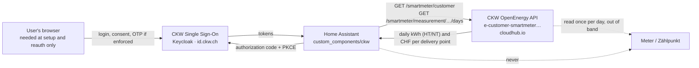
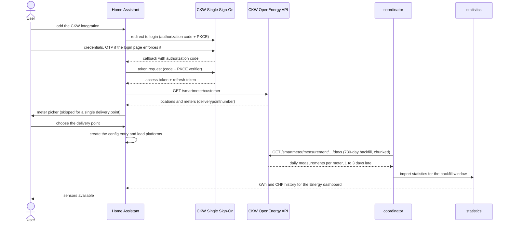

# Architecture

This page answers: which systems talk to each other, how the integration is split into modules, and
what happens between the first login and a populated Energy dashboard.

`custom_components/ckw` is a `cloud_polling` integration and stores nothing of its own: it asks the CKW
OpenEnergy API for daily aggregates and hands history to long-term statistics.

## Context (arc42 §3)

- Home Assistant never talks to the meter. CKW's infrastructure reads it; the API serves the
  resulting daily aggregates, 1 to 3 days late (the contract promises only up to yesterday).
- The browser is needed at setup and at reauth only; steady state is a token refresh plus two GET
  requests per poll. Only outbound HTTPS leaves the instance: no inbound port, no webhook, no LAN
  discovery, which is why `discovery` is exempt from the quality scale.

## Solution strategy (arc42 §4)

- **OAuth2 authorization code + PKCE**, public client `oe-wigger`, no secret or password stored.
  → [ADR-0001](decisions/0001-auth-oauth2-vs-pasted-code.md)
- **Entity statistics via `async_import_statistics`**: two years of history, one row per day.
  → [ADR-0002](decisions/0002-statistics-strategy.md)
- **One device per delivery point**, ids append-only from the config entry.
  → [ADR-0003](decisions/0003-meter-device-mapping.md)
- **Poll every 2 h over a rolling 7-day window**, accepting the observed 1–3 day lag.
  → [ADR-0004](decisions/0004-poll-interval-and-data-lag.md)
- **Diátaxis documents, arc42-lite architecture**: block, decision and consequence one link apart.
  → [ADR-0005](decisions/0005-doc-structure-diataxis-arc42-lite.md)
- **One config entry per CKW customer, one coordinator per entry**: accounts stay isolated and reauth/deletion target a single entry. → [ADR-0008](decisions/0008-multi-account.md)

## Building blocks (arc42 §5)

| Module | Responsibility | ADRs |
|---|---|---|
| `const.py` | Domain, URLs, scopes, `AGGREGATIONS`, `DEFAULT_POLL_HOURS=2`, `BACKFILL_DAYS=730`, `REFRESH_SKEW` — the single place where tunables live. | [0004](decisions/0004-poll-interval-and-data-lag.md) |
| `api.py` | Typed client for the two GET endpoints (`/smartmeter/customer`, `/smartmeter/measurement/…`): dataclasses, range chunking, rate-limit headers, `CkwApiError` / `CkwAuthError` / `CkwRateLimitError`. Imports nothing from `homeassistant`. | [0001](decisions/0001-auth-oauth2-vs-pasted-code.md), [0004](decisions/0004-poll-interval-and-data-lag.md) |
| `application_credentials.py` | Publishes the authorize and token endpoints to Home Assistant's OAuth helper as a PKCE public client. | [0001](decisions/0001-auth-oauth2-vs-pasted-code.md) |
| `config_flow.py` | User step → OAuth2 → probe `/smartmeter/customer` → meter picker when the account has more than one delivery point; plus reauth, reconfigure and the unique-entry guard. | [0001](decisions/0001-auth-oauth2-vs-pasted-code.md), [0003](decisions/0003-meter-device-mapping.md) |
| `__init__.py` | Creates API client and coordinator, builds `CkwRuntimeData` on `entry.runtime_data`, forwards the sensor platform, unloads cleanly. | [0002](decisions/0002-statistics-strategy.md), [0003](decisions/0003-meter-device-mapping.md) |
| `coordinator.py` | The `DataUpdateCoordinator`: one 2 h interval from options, a 7-day rolling `days` window, cumulative per-meter totals, and API → `ConfigEntryAuthFailed` / `UpdateFailed` / `ConfigEntryNotReady`. | [0004](decisions/0004-poll-interval-and-data-lag.md), [0002](decisions/0002-statistics-strategy.md) |
| `exceptions.py` | The `HomeAssistantError` subclasses a service raises to the user, each with `translation_domain=ckw` and a semantic `translation_key` from `strings.json` `exceptions:`; also the one mapping from `api.py` failures to those keys. | — |
| `entity.py` + `sensor.py` | `CoordinatorEntity` base with `has_entity_name` and a per-meter `DeviceInfo` under a service device; one `SensorEntityDescription` per measurement (cumulative kWh, cumulative CHF, yesterday's kWh, HT/NT detail, last update). | [0003](decisions/0003-meter-device-mapping.md), [0002](decisions/0002-statistics-strategy.md) |
| `statistics.py` | Idempotent import: recompute the cumulative sum for the window and overwrite instead of appending; 730-day backfill in chunks; skip unchanged windows. | [0002](decisions/0002-statistics-strategy.md), [0004](decisions/0004-poll-interval-and-data-lag.md) |
| `diagnostics.py` | Downloadable redacted dump: masked delivery points, token-free entry data, coordinator state, quality flags. | [0003](decisions/0003-meter-device-mapping.md) |

Layering: `const` → `api` → `exceptions`/`coordinator` → `entity`/`sensor`/`statistics`; crosscutting rules live
once in [conventions](../reference/conventions.md).

## Runtime view (arc42 §6)

First setup, the only sequence here; steady state is the same without the user.

- **Steady-state poll.** Every 2 h the coordinator refetches the last 7 days (`days` aggregation),
  merges and re-imports them; a corrected day overwrites, an unchanged window is skipped.
- **Token refresh.** `OAuth2Session` refreshes before expiry, silently across restarts; without
  `offline_access` the 2 h poll keeps the 6 h refresh token alive.
- **Failure path.** `401`/`403` → `ConfigEntryAuthFailed` → reauth, never a retry with a fresh login;
  `429` → `UpdateFailed` naming `x-ratelimit-reset`, entities unavailable until the next interval;
  network errors are `ConfigEntryNotReady` at setup, `UpdateFailed` afterwards.

## Appendix — arc42 chapter index

| arc42 | Quadrant + document | Issue |
|---|---|---|
| 1 Einführung und Ziele | meta: `GOAL.md` + `README.md` | #23, #94 |
| 2 Randbedingungen | [data-model.md](data-model.md) — once-per-day read, rate limits, VAT | #125 |
| 3 Kontextabgrenzung | this page, context diagram | #92 |
| 4 Lösungsstrategie | this page, solution strategy + the ADRs it points to | #92, #93 |
| 5 Bausteinsicht | this page, building-block table | #92 |
| 6 Laufzeitsicht | this page, one setup sequence | #92 |
| 7 Verteilungssicht | `scripts/dev/README.md` (Podman) + [install](../how-to/install.md) | #44, #121 |
| 8 Querschnittliche Konzepte | [conventions](../reference/conventions.md) — errors, redaction, timezone, ids | #129 |
| 9 Architekturentscheidungen | [decisions/](decisions/README.md) — ADRs, index in `decisions/README.md` | #93 |
| 10 Qualitätsanforderungen | `quality_scale.yaml` + [quality scale](../reference/quality-scale.md) | #101, #102 |
| 11 Risiken und technische Schuld | risk register in `PLAN.md` + "Consequences" of each ADR | — |
| 12 Glossar | [glossary](../reference/glossary.md) | #126 |

Deliberately omitted: formal arc42 view templates, §7 deployment (a development procedure, so it lives
in the Podman runbook) and §11 as a document (risks change weekly; `PLAN.md` and each ADR's
consequences are the honest place).

## Related

- [Data model](data-model.md) · [ADR index](decisions/README.md) — constraints and rejected
alternatives.
- [OpenEnergy API reference](../reference/ckw-openenergy-api.md) · [Entities](../reference/entities.md)
  · [Glossary](../reference/glossary.md) · [Conventions](../reference/conventions.md)
- [Install](../how-to/install.md) · [Reauthenticate](../how-to/reauthenticate.md) · [Backfill
  history](../how-to/backfill-history.md) · [Debug](../how-to/debug-connection.md) · [Getting
  started](../tutorial/getting-started.md) · [PLAN.md](../../PLAN.md)
